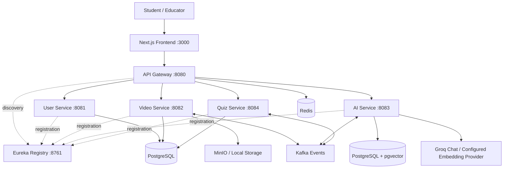

# VidyaAI

### Turn video lessons into active learning.

VidyaAI is an AI-powered learning platform for transforming video content into summaries, structured study notes, quizzes, and contextual AI conversations. It combines a Next.js frontend with Java Spring Boot microservices for user management, video workflows, AI content generation, and learning assessments.

> **Project status:** Under active development. The repository contains application code and configuration; running the complete platform requires external infrastructure, provider credentials, and integration configuration. Feature availability depends on those services.

## Contents

- [Features](#features)
- [Architecture](#architecture)
- [Technology stack](#technology-stack)
- [Repository structure](#repository-structure)
- [Local setup](#local-setup)
- [Configuration](#configuration)
- [API overview](#api-overview)
- [Development commands](#development-commands)
- [Troubleshooting](#troubleshooting)
- [Contributing](#contributing)

## Features

The codebase includes the following modules and workflows:

- **Video learning workspace:** Video uploads, YouTube URL submission, video library, processing status, and lesson views.
- **AI study materials:** Transcript extraction workflows, video summaries, structured notes, and quiz generation.
- **Contextual AI tutoring:** Chat interfaces and backend retrieval-augmented generation (RAG) components backed by pgvector.
- **Quizzes and assessment:** Quiz attempts, scoring, results, and progress-related interfaces.
- **Account management:** Registration, login, refresh tokens, profile management, and role-based access controls.
- **Learning dashboard:** Progress views, charts, notifications, and leaderboard screens.
- **Administration:** Interfaces for managing users and videos.
- **Responsive interface:** Light/dark themes and layouts for desktop and mobile.
- **Backend infrastructure:** Service discovery, gateway routing, Redis caching, Kafka events, health endpoints, and resilience configuration.

These describe the source modules, rather than a claim that every workflow has been verified end to end in a deployed environment.

## Architecture



The gateway routes public API requests to services discovered through Eureka. Each domain service has its own database. Video and AI components contain asynchronous event-processing workflows; their Kafka listeners must be enabled for automatic processing.

## Technology stack

| Layer | Technologies |
| --- | --- |
| Frontend | Next.js 16, React 19, TypeScript 5 |
| UI | Tailwind CSS 4, shadcn/ui, Base UI, Lucide, Framer Motion |
| Client state and data | TanStack Query, Zustand, Axios |
| Forms and validation | React Hook Form, Zod |
| Charts and content | Recharts, React Markdown |
| Backend | Java 21, Spring Boot, Spring Security, Spring Data JPA |
| Service infrastructure | Spring Cloud Gateway MVC, Netflix Eureka, Resilience4j |
| AI | Spring AI, Groq integration, pgvector |
| Persistence and messaging | PostgreSQL, Flyway, Redis, Apache Kafka |
| File storage | MinIO / local filesystem |
| API documentation and monitoring | Springdoc OpenAPI, Actuator, Prometheus metrics |
| Build tools | Maven Wrapper, npm |

## Repository structure

```text
vidyaAI/
├── Vidyaai-frontend/
│   └── vidyaai-frontend/       # Next.js application
├── vidyaai-api-gateway/        # API routing, JWT validation, rate limiting
├── vidyaai-service-registry/   # Eureka service discovery
├── vidyaai-userservices/       # Authentication, profiles, user management
├── vidyaai-videoservices/      # Videos, metadata, storage, processing events
├── vidyaai-aiservices/         # Transcripts, summaries, notes, quizzes, chat
├── vidyaai-quizservices/       # Quiz attempts, scoring, assessment logic
└── README.md
```

## Local setup

### 1. Prerequisites

Install Java JDK 21, a Node.js version compatible with the pinned Next.js release, npm, and PostgreSQL with pgvector support. Run Redis, Kafka, and MinIO for the corresponding backend integrations. Maven Wrapper scripts are included in each backend module.

There is currently no root Docker Compose configuration or single command that provisions the complete platform.

### 2. Clone the repository

```bash
git clone https://github.com/kumarabhinay2000/vidyaAI.git
cd vidyaAI
```

### 3. Prepare databases and infrastructure

The checked-in development configuration uses PostgreSQL at `localhost:5432` with these databases:

| Service | Database | Application port |
| --- | --- | --- |
| User | `user_db` | `8081` |
| Video | `video_db` | `8082` |
| AI | `ai_db` | `8083` |
| Quiz | `quiz_db` | `8084` |

Create the databases using your PostgreSQL administrator account:

```sql
CREATE DATABASE user_db;
CREATE DATABASE video_db;
CREATE DATABASE ai_db;
CREATE DATABASE quiz_db;
```

The AI database requires the `vector` and `pgcrypto` extensions. Install the pgvector extension on the PostgreSQL server and ensure the migration account can create extensions, or have an administrator create them in `ai_db`. Migration scripts live in each service's `src/main/resources/db/migration` directory.

Default infrastructure addresses are Redis at `localhost:6379`, Kafka at `localhost:9092`, and MinIO at `http://localhost:9000`. Ensure the MinIO bucket and access credentials match the video service configuration.

### 4. Set backend environment variables

Set variables in each service's terminal or IDE run configuration. For example, in PowerShell:

```powershell
$env:SPRING_PROFILES_ACTIVE = "dev"
$env:DB_PASSWORD = "<your-local-postgres-password>"
$env:JWT_SECRET = "<same-secure-secret-for-all-jwt-services>"
```

Use the same JWT secret across the user, video, quiz, and gateway services. Match its encoding and length to the JWT implementation. The development user, AI, and quiz profile files explicitly use the PostgreSQL username `postgres`; use Spring's standard `SPRING_DATASOURCE_USERNAME` override when needed.

For the AI service, also configure:

```powershell
$env:GROQ_API_KEY = "<your-groq-api-key>"
$env:GROQ_MODEL = "<chat-model-available-to-your-account>"
```

Example environment files are reference templates. Spring Boot does **not** automatically load a plain `.env` file; export variables or configure your IDE to load them. Some example database ports differ from the development YAML, so treat the active profile configuration as the source of truth.

### 5. Start backend services

Open a separate terminal for each service. From the repository root, start the registry first:

```powershell
cd vidyaai-service-registry
.\mvnw.cmd spring-boot:run
```

Then run the same Maven command from each of these directories:

1. `vidyaai-userservices`
2. `vidyaai-videoservices`
3. `vidyaai-aiservices`
4. `vidyaai-quizservices`
5. `vidyaai-api-gateway`

On macOS/Linux, use `./mvnw spring-boot:run` instead; grant the wrapper executable permission if needed.

Open the Eureka dashboard at `http://localhost:8761` to check service registration.

### 6. Start the frontend

```powershell
cd Vidyaai-frontend/vidyaai-frontend
npm ci
Copy-Item .env.example .env.local
npm run dev
```

On macOS/Linux, replace the copy command with `cp .env.example .env.local`.

The frontend defaults are:

```dotenv
NEXT_PUBLIC_APP_URL=http://localhost:3000
NEXT_PUBLIC_API_URL=http://localhost:8080/api
NEXT_PUBLIC_WS_URL=ws://localhost:8080/ws
```

Open `http://localhost:3000`. Frontend-specific details are in the [frontend README](Vidyaai-frontend/vidyaai-frontend/README.md).

## Configuration

| Setting | Purpose |
| --- | --- |
| `SPRING_PROFILES_ACTIVE` | Select the active backend profile |
| `DB_PASSWORD` | Database password used by the checked-in local configuration |
| `SPRING_DATASOURCE_URL` / `SPRING_DATASOURCE_USERNAME` | Standard Spring overrides for the database connection |
| `JWT_SECRET` | Shared signing/validation secret for JWT services |
| `GROQ_API_KEY` / `GROQ_MODEL` | AI chat provider credentials and model |
| `EUREKA_SERVER_URL` | Registry URL in service configurations that reference this variable |
| `MINIO_ENDPOINT` / `MINIO_ACCESS_KEY` / `MINIO_SECRET_KEY` / `MINIO_BUCKET` | Video object storage connection |
| `YOUTUBE_API_KEY` | YouTube API integration |
| `SPRING_KAFKA_LISTENER_AUTO_STARTUP` | Enable configured Kafka listeners when the broker and topics are ready |
| `NEXT_PUBLIC_API_URL` | Frontend gateway base URL |
| `NEXT_PUBLIC_WS_URL` | Frontend WebSocket endpoint |

Review each service's `application.yaml`, `application.yml`, and profile overrides for its complete configuration. Generic environment variable names only take effect where the configuration references them; use standard Spring property overrides otherwise.

### Integration notes

- Kafka listener `auto-startup` is disabled in several checked-in service configurations. Set `SPRING_KAFKA_LISTENER_AUTO_STARTUP=true` for the relevant services after configuring Kafka to enable automatic event consumption.
- The AI service configures chat and embeddings separately. Verify that your embedding provider supports the configured embedding model and the **768-dimensional** pgvector store; chat credentials alone do not establish embedding support.
- MinIO is enabled by default in the video service. To use the local storage implementation, set `STORAGE_MINIO_ENABLED=false` and review its filesystem/public URL settings.
- The frontend contains WebSocket connection code. Live updates require a reachable backend endpoint and appropriate gateway configuration; verify this integration in your environment.
- Keep real credentials in environment variables or a secret manager. Frontend `NEXT_PUBLIC_*` values are exposed to the browser and must not contain secrets.

## API overview

Requests normally pass through `http://localhost:8080`.

| API prefix | Responsibility |
| --- | --- |
| `/api/auth` | Registration, login, token refresh, logout |
| `/api/users` | User profiles and administration |
| `/api/videos` | Video management and processing status |
| `/api/ai/transcript` | Transcript extraction and retrieval |
| `/api/ai/summary` | Summary generation and retrieval |
| `/api/ai/notes` | Study note generation and retrieval |
| `/api/ai/quiz` | AI quiz generation |
| `/api/ai/chatbot` | Contextual questions and answers |
| `/api/quizzes` | Quiz and assessment workflows |

Protected endpoints require an access token:

```http
Authorization: Bearer <access-token>
```

Controller classes and request DTOs define the exact endpoints and payloads. Backend modules include Springdoc dependencies for API documentation. Actuator health is available at `/actuator/health` on services where enabled; detailed health may depend on database, Redis, and other infrastructure availability.

## Development commands

Run frontend commands inside `Vidyaai-frontend/vidyaai-frontend`:

```bash
npm run dev       # Development server
npm run lint      # ESLint
npm run build     # Production build
npm run start     # Serve a completed production build
```

Run backend commands inside the individual service directory:

```powershell
.\mvnw.cmd test           # Run that module's tests
.\mvnw.cmd clean package  # Compile, test, and package that module
```

Tests that load a Spring context may require configured credentials and external infrastructure. Each backend service is an independent Maven project; there is no root Maven aggregator.

## Troubleshooting

| Symptom | Check |
| --- | --- |
| Service fails during database startup | Database exists, credentials are exported, active profile and PostgreSQL port are correct |
| AI migration cannot create `vector` | pgvector is installed and the migration user has extension permissions |
| Gateway returns service unavailable | Target service is running and registered in Eureka |
| Videos do not trigger AI processing | Kafka broker/topics, listener auto-startup, and consumer logs |
| AI generation or chat fails | Provider key, supported model, transcript availability, and embedding configuration |
| Video upload storage error | MinIO availability, bucket, credentials, or local storage settings |
| Frontend cannot reach APIs | `NEXT_PUBLIC_API_URL`, gateway availability, CORS, and authentication |
| Live progress does not update | WebSocket endpoint, routing, and browser connection errors |

## Contributing

1. Create a branch for your change.
2. Keep changes focused on the relevant service or frontend module.
3. Run the applicable lint, build, or tests with the required infrastructure.
4. Open a pull request explaining the behavior change and validation performed.

Never commit real API keys, passwords, private environment files, generated build output, logs, or `node_modules`.

## Author

**Abhinay Kumar** · [GitHub](https://github.com/kumarabhinay2000)

## License

No repository-wide license file is currently included. Add an explicit root license before distributing or reusing the project under a particular license.
